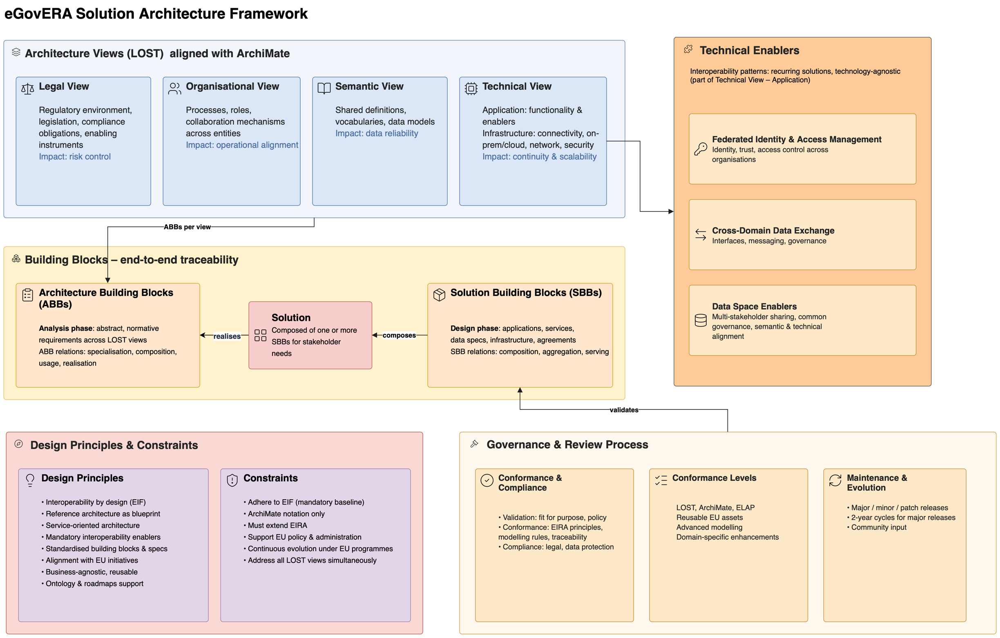
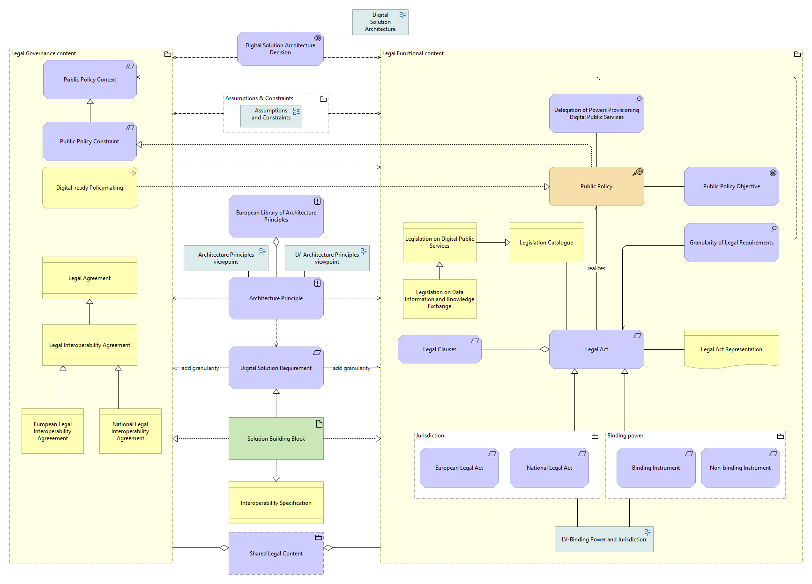
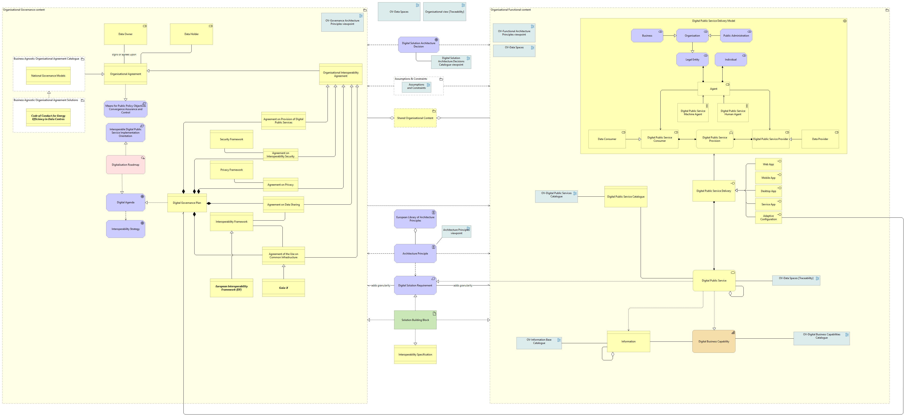
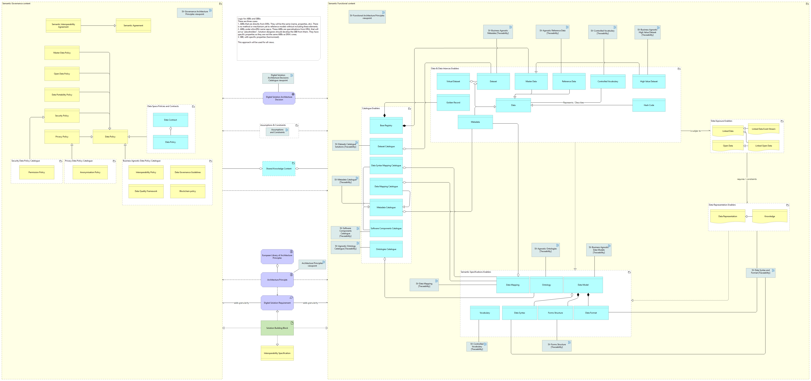
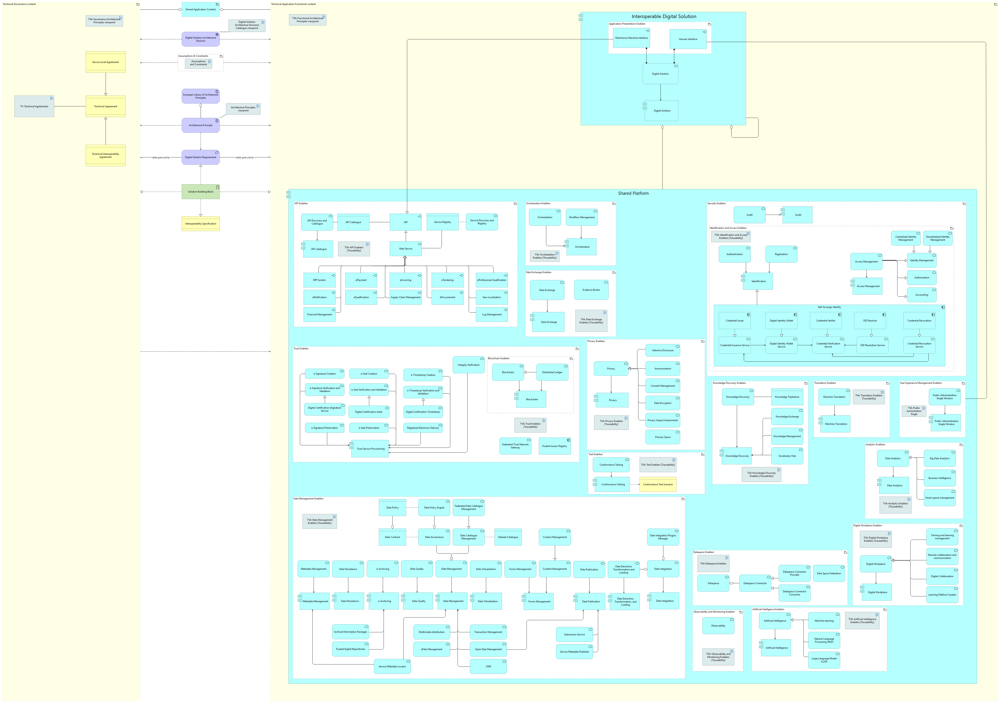
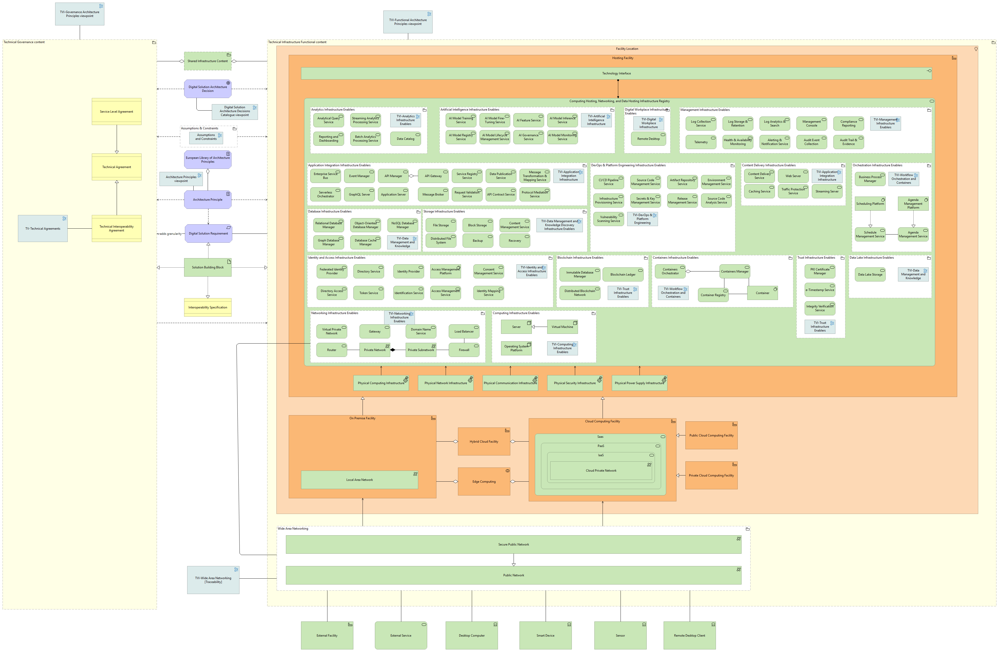

eGovERA Solution Architecture Framework
=======================================

         views (Legal, Organisational, Semantic, Technical) feed Architecture
         Building Blocks in the Analysis phase, which are realised by Solution
         Building Blocks in the Design phase and composed into a Solution.
         Technical enablers, design principles and constraints, and the
         governance and review process frame the whole.

   Figure 1: eGovERA Solution Architecture Framework – Views, Building Blocks and Governance

The eGovERA Solution Architecture Framework brings together four elements,
summarised in Figure 1.

**Architecture views**
   The framework describes a solution through the four LOST views of EIRA,
   expressed in ArchiMate®:

   - the **Legal** view covers the regulatory environment and compliance
     obligations;
   - the **Organisational** view covers processes, roles and collaboration
     between entities;
   - the **Semantic** view covers shared definitions, vocabularies and data
     models;
   - the **Technical** view covers both application functionality and the
     supporting infrastructure.

**Building blocks and traceability**
   Each view contributes Architecture Building Blocks (ABBs), which express
   abstract, normative requirements during the Analysis phase. During the
   Design phase, ABBs are realised by Solution Building Blocks (SBBs) such as
   applications, services, data specifications, infrastructure and agreements.
   A solution is composed of one or more SBBs. The realisation relationship
   between ABBs and SBBs gives end-to-end traceability from requirement to
   implementation choice.

**Technical enablers**
   Federated Identity and Access Management, Cross-Domain Data Exchange and
   Data Space Enablers are recurring, technology-agnostic groupings of ABBs in
   the Technical – Application view.
   .. This needs to be handled before publishing it. This section is poor and does not represent the reality. 

**Principles, constraints and governance**
   Design principles (interoperability by design, reuse of standardised
   building blocks, alignment with EU initiatives) and constraints (EIF as
   mandatory baseline, ArchiMate notation, extension of EIRA, coverage of all
   LOST views) bound every design. Solution architectures are then reviewed
   for validation, conformance and compliance, and the framework itself
   evolves through major, minor and patch releases.

The sections that follow describe each of these elements in detail.

Architecture Views
------------------

The European Interoperability Reference Architecture (EIRA) establishes a
structured approach to interoperability by separating concerns into four
complementary views: **Legal**, **Organisational**, **Semantic** and
**Technical**.

This structure ensures that risks related to compliance, coordination, data
consistency and technology integration are addressed holistically rather than
in isolation, reducing the likelihood of fragmented or incompatible digital
public services. By organising these concerns into distinct but aligned views,
the framework enables decision-makers to understand how regulatory
obligations, operational processes, information exchange, applications and
system infrastructure collectively influence public service delivery
outcomes.

Legal View
~~~~~~~~~~

The Legal view focuses on the regulatory environment that governs digital
services.

- **Primary implication – risk control.** Failure to properly account for
  legislation, compliance obligations or legal constraints can result in
  service disruption, penalties, or inability to operate across
  jurisdictions.
- **What it ensures.** By explicitly modelling these elements, the
  architecture ensures that interoperability initiatives are viable within
  existing legal frameworks and that enabling instruments are clearly
  identified.

   Figure 2: Legal View

Organisational View
~~~~~~~~~~~~~~~~~~~

The Organisational view addresses how services are delivered in practice,
defining the processes, roles and collaboration mechanisms required across
entities.

- **Primary implication – operational alignment.** Without clearly defined
  responsibilities and coordinated workflows, even technically sound systems
  may fail to deliver consistent outcomes.
- **What it ensures.** Participating organisations can work together
  effectively, reducing inefficiencies and duplication of effort.

   Figure 3: Organisational View

Semantic View
~~~~~~~~~~~~~

The Semantic view ensures that information exchanged between systems is
consistently understood.

- **Primary implication – data reliability.** Without shared definitions,
  standardised vocabularies and agreed data models, information may be
  misinterpreted, leading to errors in decision-making and service
  execution.
- **What it ensures.** A common meaning for data across organisational
  boundaries.

   Figure 4: Semantic View

Technical View
~~~~~~~~~~~~~~

The Technical view enables the actual exchange of data and communication
between systems. It encompasses both application-level functionality and the
underlying infrastructure required for connectivity.

- **Primary implication – service continuity and scalability.**
- **What it ensures.** Systems can interact reliably and securely despite
  differences in technology platforms, deployment models (such as
  on-premises or cloud environments), network configurations and security
  frameworks.

   Figure 5: Technical View – Application

   Figure 6: Technical View – Infrastructure

Modelling Standard
~~~~~~~~~~~~~~~~~~

To support consistency across all views, the architecture aligns with
ArchiMate®, an internationally recognised modelling standard. This alignment
ensures broad acceptance and provides a unified method to represent
governance constraints, business operations, data structures and technology
components, thereby strengthening coherence across the entire architecture.

.. seealso::

   The European Interoperability Reference Architecture (EIRA) Specification
   for further information.

Design Principles
-----------------

The overarching objective of the design principles is to ensure that digital
public services deliver consistent value across European administrations
while remaining adaptable to future policy and technological developments.

The following principles guide every solution design:

**Interoperability by design**
   Directly translates into reduced fragmentation between national systems
   and more seamless cross-border service delivery. By aligning system design
   with the European Interoperability Framework (EIF) guidelines,
   administrations can minimise integration costs and avoid duplicative
   investments, improving efficiency and accelerating service roll-out.

**Reference architecture as a reusable blueprint**
   Ensures that systems are not developed in isolation but follow a
   consistent and proven structure. This strengthens quality assurance and
   reduces implementation risk, as architectural decisions are guided by
   validated models rather than ad hoc design choices.

**Service-oriented architecture style**
   Structures systems into modular, reusable services, enabling flexibility
   and scalability while supporting incremental modernisation.

**Interoperability enablers as mandatory components**
   Ensures that interoperability is not treated as an afterthought but
   embedded into the core of every system.

**Standardised building blocks and specifications**
   Streamline architecture development processes and improve compatibility
   across solutions.

**Alignment with European-level initiatives**
   Including regulatory and data-sharing frameworks, this ensures that
   systems remain compliant and strategically relevant, reducing the risk of
   future rework.

The eGovernment Reference Architecture (eGovERA) adds further value:

- **Granularity** – it adds more granular architectural specifications,
  enabling more precise analysis and design of digital public services.
- **Reuse across domains** – its business-agnostic nature maximises return
  on investment and supports diverse service needs without requiring
  redesign.
- **Guidance for Member States** – supporting tools such as the ontology and
  implementation roadmaps reduce ambiguity and accelerate adoption.

Collectively, these principles enable both modernisation and long-term
business continuity, ensuring that digital public services remain resilient.

Constraints
-----------

The constraints define the boundaries within which architectural decisions
must be made, ensuring consistency, compliance and alignment with European
public sector objectives. Each constraint brings benefits but also has
implications that must be managed.

**Adherence to the European Interoperability Framework**
   The EIF establishes a mandatory baseline for interoperability across
   legal, organisational, semantic and technical dimensions.

   - *Benefit:* all systems contribute to a cohesive ecosystem.
   - *Implication:* deviation is limited, requiring careful alignment in
     design choices.

**Use of the ArchiMate modelling notation**
   ArchiMate standardises how systems are described and analysed.

   - *Benefit:* enhanced clarity, comparability and governance.
   - *Implication:* requires specialised expertise and may limit flexibility
     in expressing concepts outside the notation's scope.

**Extension of the European Interoperability Reference Architecture**
   All designs are inherently dependent on, and must remain compatible
   with, the EIRA specifications.

   - *Benefit:* reduced inconsistency.
   - *Implication:* reliance on upstream updates and governance decisions.

**Alignment with EU policy and public administration**
   All designs must directly support European Union policy objectives and
   administrative processes.

   - *Benefit:* relevance and public value.
   - *Implication:* may restrict purely technical optimisation where it
     conflicts with policy considerations.

**Continuous evolution under European Union programmes**
   Architectures must adapt in line with programme priorities and
   timelines.

   - *Implication:* potential impact on stability and long-term planning.

**Simultaneous coverage of the LOST views**
   Designs must account not only for technical implementation but also for
   legal compliance, organisational structures and semantic consistency.

   - *Benefit:* stronger interoperability and reduced systemic risk.
   - *Implication:* greater complexity and coordination, which can extend
     development timelines.

Reference Architectures and Enablers
------------------------------------

Interoperability patterns play a central role in this approach. Patterns
capture recurring solutions to common challenges without prescribing
specific technologies. Instead, they define stable combinations of
responsibilities, interactions and constraints that can be implemented in
different ways.

The main enablers are:

**Federated Identity and Access Management**
   Addresses authentication and authorisation across organisational
   boundaries. It relies on identity, trust and access control
   capabilities.

**Cross-Domain Data Exchange**
   Enables controlled data sharing between heterogeneous systems, supported
   by interoperability interfaces, messaging and governance mechanisms.

**Data Space Enablers**
   Extend this further by supporting multi-stakeholder data sharing through
   common governance, and semantic and technical alignment.

.. note::

   These enablers can be identified as part of the **Technical View –
   Application** in the EIRA / eGovERA reference architecture.

Building Blocks
---------------

This section provides an overview of the Architecture and Solution Building
Blocks present in EIRA and eGovERA. A comprehensive list can be found in the
*Reference Architecture documentation and publication*, published
separately.

Architecture Building Blocks (ABBs)
~~~~~~~~~~~~~~~~~~~~~~~~~~~~~~~~~~~

Architecture Building Blocks (ABBs) define the essential requirements to
design consistent and interoperable digital public services, enabling
organisations to align solutions with strategic and regulatory expectations
from the outset. By establishing a common understanding of what must be
achieved, they reduce ambiguity in system design and support more
predictable outcomes across initiatives.

Key characteristics of ABBs:

- **Abstract components.** An ABB captures architecture requirements and
  guides solution development. Rather than prescribing specific
  implementations, it defines reusable capabilities spanning the legal,
  organisational, semantic and technical views. This lets decision-makers
  focus on *what* a system must accomplish without being constrained by
  *how* it is implemented, supporting flexibility and long-term
  adaptability.
- **Normative requirement statements.** ABBs are requirement statements of
  intermediate granularity, aligned with the European Interoperability
  Framework principles and expressed as functional expectations tied to
  attributes of European public services. Solutions developed using these
  definitions therefore reflect agreed standards and policy objectives,
  reducing the risk of misalignment with regulatory frameworks.
- **Generic, not concrete.** ABBs describe generic characteristics and
  functionalities rather than concrete solutions. They are used to model
  reference architectures and solution templates, providing a structured
  foundation for consistent system analysis. This enables reuse and
  comparability across projects while mitigating the risk of fragmentation
  or duplication of effort in large-scale public sector environments.

ABBs in EIRA and eGovERA
^^^^^^^^^^^^^^^^^^^^^^^^

Within EIRA and eGovERA, ABBs serve as the core elements of the architecture
model used to represent requirements. They are identified across all LOST
views (Legal, Organisational, Semantic, Technical) and are modelled using the
appropriate ArchiMate elements, depending on the nature of the requirement
and the corresponding interoperability view.

ABBs represent and model the requirements captured during the **analysis
phase**, typically originating from a request for architecture development
(e.g. within an intervention). In this context, eGovERA provides a
structured and formal mechanism to document requirements, ensuring that they
are consistently modelled, reusable and machine-readable.

Beyond their identification, ABBs must be properly integrated within the
architecture model through the definition of relationships with other
elements:

- **Relationships between ABBs** – such as specialisation, composition,
  usage or realisation – structure requirements at different levels of
  abstraction and capture dependencies within and across LOST views.
- **Relationships between ABBs and SBBs** – such as realisation or usage,
  established during the design phase – ensure that each requirement is
  explicitly related to one or more solution elements.

These relationships are expressed using ArchiMate notation and may be
defined either within the same view and viewpoints, or across LOST views.

Explicitly modelling these relationships is essential to ensure end-to-end
traceability, linking requirements across different levels of abstraction
and enabling a clear connection between ABBs and their corresponding SBBs in
the solution architecture.

.. seealso::

   The EIRA Reference Architecture documentation and publication, for
   further details on ABB specifications and modelling conventions.

Solution Building Blocks (SBBs)
~~~~~~~~~~~~~~~~~~~~~~~~~~~~~~~

Solution Building Blocks (SBBs) translate architectural intent into
operational reality, enabling organisations to deliver tangible digital
services that meet the requirements defined as ABBs. Their primary value
lies in bridging the gap between abstract design and concrete
implementation, ensuring that strategic objectives are effectively realised.

Key characteristics of SBBs:

- **Realisation of ABBs.** An SBB is a concrete implementation or
  specification that realises an ABB, specialising the abstract capabilities
  previously defined. This keeps implementation decisions aligned with
  architectural requirements, reducing the risk of divergence between design
  and execution.
- **Modular composition.** Solutions are composed of one or more SBBs
  assembled to meet specific stakeholder needs. This supports flexibility,
  allowing organisations to adapt or extend solutions without redesigning
  entire systems, and facilitates reuse, which can lead to cost efficiencies
  and faster delivery.
- **Tangible components.** At the implementation level, SBBs represent
  components such as specifications, applications, services or
  infrastructure elements. By embodying the functionality described at the
  architectural level, they provide the operational mechanisms required to
  deliver digital public services.

.. important::

   The effectiveness of SBBs depends on maintaining alignment with the
   underlying architectural definitions: deviations can introduce
   interoperability risks or reduce system coherence.

SBBs in EIRA and eGovERA
^^^^^^^^^^^^^^^^^^^^^^^^

Within EIRA and eGovERA, SBBs represent the core elements of the
architecture model used to define the solution. They correspond to the
concrete realisation of requirements and are identified across all LOST
views (Legal, Organisational, Semantic, Technical). They are modelled using
the appropriate ArchiMate elements, depending on the type of solution
component and the corresponding interoperability layer.

SBBs are defined during the **design phase**, where the requirements
captured as ABBs in the analysis phase are translated into implementable
solution components. These may include applications, services, data
specifications, infrastructure components or agreements. In this context,
eGovERA provides a structured and formal mechanism to document solution
architectures, ensuring consistency, reuse and machine-readable
representation.

As with ABBs, SBBs must be properly integrated within the architecture model
through the definition of relationships with other elements:

- **Relationships between SBBs** – such as composition, aggregation or
  serving – describe how solution components interact and are structured
  within and across LOST views.
- **Relationships between SBBs and ABBs** – such as realisation or usage –
  ensure that each solution element is explicitly linked to the requirements
  it realises, maintaining consistency between analysis and design.

These relationships are expressed using ArchiMate notation and may be
defined either within the same view and viewpoints, or across LOST views.

Explicitly modelling these relationships is essential to ensure end-to-end
traceability, linking solution components to their corresponding
requirements and enabling a coherent and verifiable solution architecture.

.. seealso::

   The EIRA Reference Architecture documentation and publication, for
   further details on SBB specifications and modelling conventions.

Governance and Review Process
-----------------------------

Conformance and Compliance
~~~~~~~~~~~~~~~~~~~~~~~~~~

Governance within EIRA and eGovERA is structured around three
complementary assessments:

**Validation**
   Assesses whether the architecture meets functional, non-functional and
   interoperability requirements. It focuses on fitness for purpose and
   alignment with policy objectives.

**Conformance**
   Evaluates whether the architecture correctly applies EIRA and eGovERA
   principles, building blocks and modelling rules. It ensures that
   interoperability is embedded by design and that traceability between
   requirements and solutions is maintained. This process may involve
   automated checks and expert review.

**Compliance**
   Addresses adherence to legal and regulatory requirements. It ensures that
   solutions can be deployed within the European legal framework, including
   data protection, sector-specific legislation and broader policy
   obligations. Failure to meet compliance requirements presents significant
   legal and operational risks.

Conformance Levels
~~~~~~~~~~~~~~~~~~

Conformance is structured across three levels. This tiered approach allows
proportional application across different contexts.

.. list-table::
   :header-rows: 1
   :widths: 18 42 40

   * - Level
     - Purpose
     - Examples
   * - **Mandatory**
     - Establishes the baseline requirements, essential for any solution
       claiming alignment.
     - Use of the LOST views, ArchiMate modelling and ELAP principles.
   * - **Recommended**
     - Enhances quality and interoperability. Not required, but its adoption
       improves sustainability.
     - Use of reusable EU assets and advanced modelling practices.
   * - **Optional**
     - Provides flexibility without compromising core principles.
     - Domain-specific or performance-related enhancements.

Maintenance and Evolution
~~~~~~~~~~~~~~~~~~~~~~~~~

The reference architecture follows a structured lifecycle to remain relevant
and responsive to user needs. Changes are categorised by their impact:

- **Major releases** introduce structural modifications and require careful
  transition planning.
- **Minor and patch releases** maintain continuity with the current
  structure.

To support sustainability, the evolution and maintenance process is
organised in **two-year cycles**: major releases happen only every two
years, in line with community needs. This ensures that the architecture can
evolve without disrupting its core structure.

Ongoing community input plays a key role in keeping the architecture relevant
and practical.
