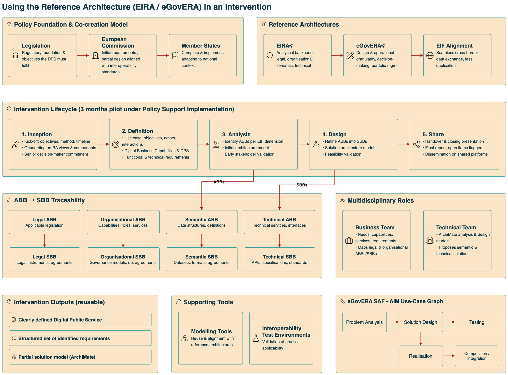

Usage Guidance and Methodology for an Intervention
==================================================

Using the Reference Architecture in an Intervention
---------------------------------------------------

The use of reference architectures within an intervention directly
translates policy objectives into structured, interoperable solution
designs, reducing fragmentation and increasing consistency across public
services.

Two reference architectures work together:

**EIRA© – the analytical backbone**
   The European Interoperability Reference Architecture (EIRA©) enables
   stakeholders to systematically assess requirements across legal,
   organisational, semantic and technical dimensions. This ensures that all
   relevant constraints and dependencies are identified early, mitigating the
   risk of misalignment between policy intent and operational delivery.

**eGovERA© – from analysis to design**
   Building on this analytical foundation, the eGovernment Reference
   Architecture (eGovERA©) extends the process into the design and
   operational domain. By introducing greater granularity and domain-specific
   guidance, it supports decision-making and portfolio management, allowing
   administrations to move from conceptual alignment to actionable solution
   design. This progression is critical for maintaining coherence while
   enabling flexibility in implementation.

Traceability between ABBs and SBBs
~~~~~~~~~~~~~~~~~~~~~~~~~~~~~~~~~~

A central mechanism in this process is the traceability between
Architecture Building Blocks (ABBs) and Solution Building Blocks (SBBs):

- **ABBs** define normative requirements derived from policy and
  interoperability needs.
- **SBBs** translate these requirements into implementable components or
  standards to be used.

This traceability ensures that every element of the final design can be
directly linked back to its originating requirement, reducing ambiguity and
supporting accountability. In practice:

.. list-table::
   :header-rows: 1
   :widths: 50 50

   * - ABBs cover elements such as…
     - …which SBBs operationalise into
   * - Applicable legislation
     - Legal agreements
   * - Organisational capabilities
     - Governance models
   * - Data structures
     - Datasets
   * - Technical services
     - Application interfaces

Alignment with the European Interoperability Framework (EIF) ensures that
this structured approach supports seamless cross-border data exchange,
reducing duplication and enabling scalable digital public services.

An Intervention at a Glance
~~~~~~~~~~~~~~~~~~~~~~~~~~~

         Analysis, Design and Share – set against the policy and co-creation
         model, the reference architectures EIRA and eGovERA, ABB-to-SBB
         traceability per LOST view, the business and technical teams,
         supporting tools and the reusable outputs of an intervention.

   Figure 7: Using the Reference Architecture in an Intervention – Phases, Roles and Outputs

An intervention applies the reference architecture to a concrete Digital
Public Service (DPS) over a pilot of about three months. Figure 7 shows how
the work is organised.

The intervention starts from legislation, which sets the objectives the DPS
must meet. The European Commission provides initial requirements and a
partial design aligned with interoperability standards, and Member States
complete and implement it in their national context. EIRA and eGovERA
provide the architectural reference throughout, in line with the EIF.

The intervention runs through five phases:

#. **Inception** – agree objectives, method and timeline; onboard
   participants on the reference architecture; secure commitment from a
   senior decision-maker.
#. **Definition** – describe the use case (objectives, actors,
   interactions), identify the Digital Business Capabilities and the DPS,
   and capture functional and technical requirements.
#. **Analysis** – identify the ABBs for each LOST view, build an initial
   architecture model and validate it early with stakeholders.
#. **Design** – refine the ABBs into SBBs, produce the solution
   architecture model and check its feasibility.
#. **Share** – hand over the results with a closing presentation and final
   report, flag open items and publish the outputs on shared platforms.

The Analysis and Design phases are linked by traceability: each Legal,
Organisational, Semantic and Technical ABB is realised by one or more SBBs
of the same view (for example, applicable legislation by legal instruments
and agreements, or technical services by APIs and specifications).

The work is carried out by a business team, which captures needs,
capabilities and services and maps the legal and organisational building
blocks, and a technical team, which builds the ArchiMate models and
proposes semantic and technical solutions. Modelling tools and
interoperability test environments support both (see :doc:`tools`).

Each intervention produces three reusable outputs: a clearly defined DPS, a
structured set of requirements and a partial solution model in ArchiMate.

Definition and Purpose of an Intervention
~~~~~~~~~~~~~~~~~~~~~~~~~~~~~~~~~~~~~~~~~

An intervention serves as a targeted mechanism to translate policy
objectives into interoperable digital public services, ensuring that
interoperability is embedded from the outset rather than retrofitted later.

**What it is**
   A pilot activity under Policy Support Implementation that applies
   structured reference architectures to guide the definition and design of
   such services.

**Purpose**
   To enable seamless data exchange between public administrations,
   businesses and citizens by addressing interoperability across legal,
   organisational, semantic and technical dimensions. This comprehensive
   scope reduces the risk of isolated or incompatible solutions, which can
   lead to inefficiencies, increased costs and barriers to cross-border
   collaboration.

**Unit of analysis**
   The digital public service, understood as a service delivered by public
   administrations to achieve specific policy goals through information and
   communication technologies. By focusing on this unit, the intervention
   maintains a clear link between policy intent and service delivery
   outcomes.

**Scope and duration**
   Interventions are deliberately constrained in scope and duration,
   typically lasting around **three months**. This limited timeframe ensures
   rapid progress while focusing on producing a partial yet reusable design
   model rather than a full implementation.

   .. note::

      While this accelerates delivery, it also introduces the risk that
      incomplete specifications may require further refinement during
      subsequent implementation phases.

**Outputs**
   - A clearly defined digital public service.
   - A structured set of identified requirements.
   - A partial solution model expressed using standardised modelling
     approaches.

   These outputs provide a reusable foundation that can be extended by
   public administrations, supporting consistency and reducing duplication
   across future initiatives.

Overall Process of an Intervention
~~~~~~~~~~~~~~~~~~~~~~~~~~~~~~~~~~

The intervention process is structured to ensure that policy intent is
consistently translated into implementable solutions, reducing
fragmentation across jurisdictions.

**1. Legislation as the starting point**
   Legislation establishes the regulatory foundation and defines the
   objectives that the digital public service must fulfil.

**2. A co-creation model**
   From this starting point, a co-creation model is applied, enabling
   collaboration between central authorities and Member States:

   - The **European Commission** provides initial requirements and a
     partial design, which ensures alignment with established
     interoperability standards.
   - **Member States** then complete and implement the solution, allowing
     for adaptation to national contexts while maintaining overall
     consistency.

   This division of responsibilities balances standardisation with
   flexibility but requires careful coordination to avoid divergence during
   implementation.

**3. Multidisciplinary execution**
   Execution is inherently multidisciplinary:

   - **Business-oriented teams** focus on identifying needs, capabilities,
     and legal and organisational requirements, ensuring that the service
     aligns with policy and operational realities.
   - In parallel, **technical teams** define the data structures and
     technical components, translating requirements into design models and
     implementable elements.

   This collaboration is essential to avoid gaps between policy design and
   technical execution.

**4. Multiple dimensions of interoperability**
   Interventions address multiple dimensions of interoperability, including
   governance structures, data alignment and technical integration. This
   comprehensive approach reduces the risk of isolated solutions that fail
   to integrate across systems or jurisdictions.

**5. Supporting tools**
   Supporting tools play a critical role in maintaining consistency and
   quality. Modelling tools and interoperability test environments enable
   validation, reuse and alignment with reference architectures. These
   tools help ensure that outputs are not only theoretically sound but also
   practically applicable, thereby increasing the likelihood of successful
   implementation.

Lifecycle Phases of an Intervention
~~~~~~~~~~~~~~~~~~~~~~~~~~~~~~~~~~~

The intervention follows a structured lifecycle composed of five phases:

   **Inception** → **Definition** → **Analysis** → **Design** → **Share**

This phased approach provides a clear progression from initial engagement
to delivery and ensures that each stage builds on validated outputs from the
previous one. It also introduces control points that support stakeholder
alignment and quality assurance.

Phase 1 – Inception: Establishing alignment and commitment
^^^^^^^^^^^^^^^^^^^^^^^^^^^^^^^^^^^^^^^^^^^^^^^^^^^^^^^^^^

**Goal:** establish the strategic foundation necessary for a successful
intervention by ensuring that the public administration recognises the value
of adopting structured approaches to analysing and designing Digital Public
Services. This alignment is critical, as early misunderstanding or lack of
commitment would undermine downstream activities and delay outcomes.

**Key activities:**

- **Kick-off meeting** – clarifies objectives, methodology and expected
  timelines, creating transparency and securing agreement to proceed with a
  pilot intervention.
- **Onboarding session** – explains the architectural frameworks, including
  their organisation into distinct views and components, enabling
  stakeholders to understand how these frameworks support interoperability
  and service design.

**Engagement:** intentionally focused on senior decision-makers to ensure
institutional backing. The intervention team simultaneously fulfils:

- a **commercial function** – securing participation;
- a **training function** – building foundational knowledge.

This dual role mitigates the risk of misalignment between strategic intent
and technical execution.

Phase 2 – Definition: Scoping the intervention and formalising requirements
^^^^^^^^^^^^^^^^^^^^^^^^^^^^^^^^^^^^^^^^^^^^^^^^^^^^^^^^^^^^^^^^^^^^^^^^^^^

**Goal:** translate strategic intent into a clearly bounded and agreed
scope, reducing ambiguity and preventing scope creep during later stages.

**Key activities:**

- **Articulate the use case** – including its objectives, involved actors
  and sequence of interactions, establishing a shared understanding of the
  service to be developed or improved.
- **Identify capabilities, services and requirements** – this clarity
  enables the identification of Digital Business Capabilities and Digital
  Public Services, alongside the functional and technical requirements
  necessary to support them.
- **Validate with stakeholders** – to ensure completeness and relevance,
  minimising the risk of rework.
- **Align with architectural catalogues** – ensuring that interoperability
  considerations are embedded from the outset rather than retrofitted later,
  which would increase cost and complexity.

.. admonition:: Example

   Identifying capabilities such as *reporting cross-border transactions*
   and services such as *secure authentication* demonstrates how business
   needs are directly linked to enabling functionalities.

Phase 3 – Analysis: Translating requirements into architecture building blocks
^^^^^^^^^^^^^^^^^^^^^^^^^^^^^^^^^^^^^^^^^^^^^^^^^^^^^^^^^^^^^^^^^^^^^^^^^^^^^^

**Goal:** convert defined requirements into structured architectural
components, enabling traceability and consistency across the solution. This
step is essential for reducing implementation risk, as it ensures that all
requirements are systematically addressed within a coherent framework.

**Architecture Building Blocks per view** – each representing a set of
normative requirements aligned with interoperability principles:

- **Legal** – elements ensure compliance with applicable legislation.
- **Organisational** – components define roles, services and information
  management responsibilities.
- **Semantic** – elements establish a common understanding of data through
  shared definitions and formats.
- **Technical** – components specify the services and interfaces required to
  operationalise the solution.

**Result:** these elements are consolidated into an initial architecture
model, providing a structured representation that links business needs to
architectural components. This traceability enables early validation with
stakeholders, reducing the likelihood of misinterpretation and ensuring
alignment before progressing to detailed design.

Phase 4 – Design: Developing the solution architecture model
^^^^^^^^^^^^^^^^^^^^^^^^^^^^^^^^^^^^^^^^^^^^^^^^^^^^^^^^^^^^

**Goal:** transform abstract architectural components into concrete,
implementable solutions, bridging the gap between concept and execution.
This progression reduces uncertainty by defining how each requirement will
be realised in practice.

**Solution Building Blocks per view** – Architecture Building Blocks are
refined into Solution Building Blocks, which represent tangible elements
such as specific legal instruments, governance arrangements, datasets and
technical services:

- **Legal** – components define the exact regulatory frameworks governing
  the service.
- **Organisational** – elements establish operational agreements and
  governance structures necessary for delivery.
- **Semantic** – components specify the datasets, formats and agreements
  required for consistent data exchange.
- **Technical** – components define the services and specifications that
  enable interoperability.

**Result:** a detailed and actionable blueprint, ensuring that all elements
are aligned with recognised standards. Validation with stakeholders at this
stage ensures feasibility and acceptance, mitigating the risk of
implementation delays or redesign.

Phase 5 – Share: Handover, communication, and closure
^^^^^^^^^^^^^^^^^^^^^^^^^^^^^^^^^^^^^^^^^^^^^^^^^^^^^

**Goal:** ensure that the outcomes of the intervention are effectively
transferred, understood and positioned for implementation, safeguarding the
value generated throughout the process.

**Key activities:**

- **Structured handover** – presents the final design model alongside the
  remaining steps required for execution, ensuring continuity and clarity of
  responsibility.
- **Closing presentation** – consolidates deliverables and timelines,
  reinforcing stakeholder alignment and readiness for implementation.
- **Final report and supporting materials** – enable broader communication
  and reuse, extending the impact beyond the initial intervention.
- **Identification of outstanding elements** – such as the completion or
  alignment of datasets and semantic agreements, clearly identified to avoid
  implementation gaps.
- **Dissemination through shared platforms** – supports knowledge reuse and
  transparency, reducing duplication of effort and enhancing long-term
  interoperability across administrations.

Roles in the Intervention Process
~~~~~~~~~~~~~~~~~~~~~~~~~~~~~~~~~

The intervention requires a multidisciplinary team that combines business
and technical expertise. This reflects the dual nature of interoperable
digital public services, which must align policy objectives with technical
implementation.

.. list-table::
   :header-rows: 1
   :widths: 50 50

   * - Business team
     - Technical team
   * - Responsible for identifying needs and defining capabilities, services
       and requirements.
     - Translates these requirements into formal models and proposes
       semantic and technical solutions.
   * - Maps legal and organisational Architecture and Solution Building
       Blocks, ensuring alignment with policy and governance structures.
     - Develops the analysis and design models using ArchiMate and ensures
       that technical components are coherent and aligned with
       requirements.

.. important::

   Effective collaboration between these profiles is essential. A disconnect
   between business and technical perspectives can lead to incomplete or
   impractical designs. Conversely, strong integration supports the
   development of solutions that are both technically sound and
   operationally viable.

Aligning the Reference Architecture with Portfolio Management and Strategy Planning
-----------------------------------------------------------------------------------

The eGovERA Solution Architecture Framework (SAF) adopts a problem-solving
paradigm, structuring the implementation lifecycle around distinct use
cases.

**Primary use cases**

- **Analysis of the problem** – where requirements and constraints are
  defined.
- **Solution design** – where alternative solutions are developed in terms
  of Solution Building Blocks supported by specifications and standards.

**Additional use cases** extend the lifecycle to include:

- Testing
- Realisation
- Composition or integration

This broader scope ensures that implementation is not limited to design but
includes validation and deployment activities.

The Architecture Implementation Method (AIM) within eGovERA organises these
use cases as phases within a graph structure that allows multiple execution
sequences. This approach provides flexibility in aligning architecture work
with portfolio management and strategic planning.
